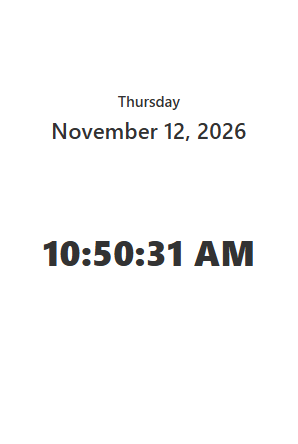
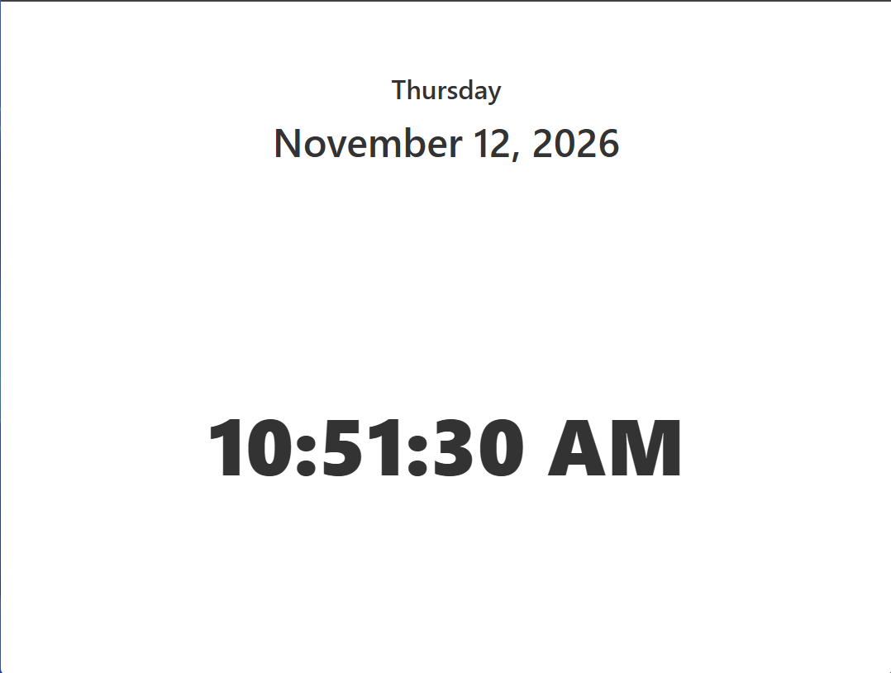

# 🕑 Digital clock

A lightweight, responsive digital clock built with vanilla JavaScript. It displays the current day, full date, and time, and automatically switches to a dark theme in the evening and early morning.

---

## 🚀 Live Demo

🔗  [JavaScript Version](https://digital-clock-ten-alpha.vercel.app)

---

## 📸 Screenshots




---

## Project Overview

This project displays the current day, full date, and time. The clock updates every second and switches to a dark theme based on the time of day.

---

## ✨ Features

- Displays the current day, full date, and time.
- Updates the clock every second.
- Switches to a dark theme from 6:00 PM to 7:59 AM.
- Adapts to mobile and desktop screens.

---

## 🛠️ Tech Stack

### Vanilla

- HTML5
- CSS3
- JavaScript (ES6 Modules)
- Vite
- Schibsted Grotesk

### React


---

## 📁 Project Structure

```
digital-clock/
├── vanilla/
│   ├── public/
│   │   ├── android-chrome-192x192.png
│   │   ├── android-chrome-512x512.png
│   │   ├── apple-touch-icon.png
│   │   ├── favicon-16x16.png
│   │   ├── favicon-32x32.png
│   │   ├── favicon.ico
│   │   └── site.webmanifest
│   ├── src/
│   │   ├── assets/
│   │   │   └── font/
│   │   │       ├── Schibsted_Grotesk/
│   │   │       ├── static/
│   │   │       ├── SchibstedGrotesk-Italic-VariableFont_wght.ttf
│   │   │       └── SchibstedGrotesk-VariableFont_wght.ttf
│   │   ├── css/
│   │   │   ├── base/
│   │   │   │   ├── fonts.css
│   │   │   │   ├── normalize.css
│   │   │   │   └── reset.css
│   │   │   └── main.css
│   │   ├── main.js
│   │   └── style.css
│   ├── .gitignore
│   ├── index.html
│   ├── package-lock.json
│   └── package.json
└── README.md
```

---

## 🎯 Learning Objectives

### JavaScript

- Work with the `Date` object.
- Select and update elements in the DOM.
- Update content at regular intervals with `setInterval`.
- Format dates and times with the `Intl` API.
- Toggle CSS classes based on the current time.

### React


---

## 🔮 Future Improvements

- Add a stopwatch.
- Add a countdown timer.
- Create a React version.

---

## ⚙️ Getting Started

### Prerequisites

- Node.js
- npm

### Vanilla JavaScript

1. Clone the repository:

```bash
   git clone https://github.com/RaulLimon3/digital-clock.git
```

2. Navigate to the Vanilla project:

```bash
   cd digital-clock/vanilla
```

3. Install dependencies:

```bash
   npm install
```

4. Start the development server:

```bash
   npm run dev
```

---

## 👨‍💻 Author

Developed by **Raúl Limón**  
Frontend Developer focused on building scalable and maintainable web applications while continuously improving JavaScript and frontend architecture skills.

- GitHub: [RaulLimon3](https://github.com/RaulLimon3)  
- LinkedIn: [Raúl Limón](https://www.linkedin.com/in/raul-limon-garcia/)